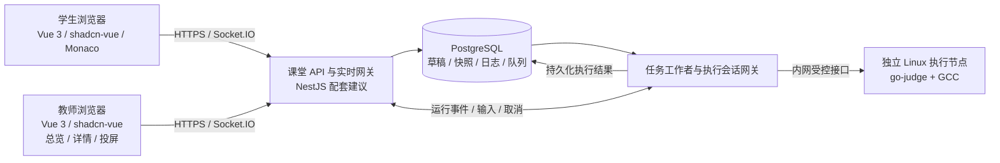

# C++ 虚拟编程教室：开源组件选型

版本：v1.1（按用户确认更新技术栈，沿用原文件名）  
调研日期：2026 年 10 月 25 日  
依据：同目录《Cpp虚拟编程教室-产品需求说明-v1.0.md》  
状态：用户已确认 go-judge、Vue／TypeScript、shadcn-vue、PostgreSQL；其他组件为配套建议。文档、官方仓库与部分源码核查完成；尚未部署、压测或进行安全验证。

## 1. 选型结论

**建议自研课堂业务，复用编辑器、通信、认证、任务队列和执行沙箱；不以完整 OJ 或完整云 IDE 作为首版底座。**

用户已确认的技术选型：

> 前端：Vue 3 + TypeScript  
> 界面组件：shadcn-vue  
> 数据库：PostgreSQL（PGSQL）  
> 执行引擎：go-judge

部署约束：用户明确不使用 Docker。前端、Node 业务服务和 PostgreSQL 均以原生进程运行；go-judge 在独立 Linux 节点原生运行，由 systemd 管理。

配套建议：Vite + Vue Router + Tailwind CSS + Monaco Editor；业务后端 NestJS + Socket.IO + Better Auth；PostgreSQL 任务队列 pg-boss；独立 Linux 执行节点使用固定版本 GCC。业务后端、认证和队列尚未由用户单独确认。

**go-judge 已确定采用，EOF、流式输出限制和取消清理属于实施与验收事项。** 核查的 v1.13.3 流式协议没有独立关闭 stdin／发送 EOF 的消息，需要执行侧扩展。后续验证用于确定接入实现、部署配置和版本，不重新选择执行引擎。

Piston、Judge0、NsJail 等保留为前期调研记录，不再列为本次实施候选。

本建议按需求文档的**建议基线**评估：单班 50 人、单文件 `main.cpp`、C++17、基础运行时输入、教师只读巡视。以上仍是产品假设，不代表本次技术栈确认同时冻结了全部产品范围。Vue／TypeScript 是已确认的前端选择，不能据此推定用户已确认 Node.js 业务后端。

## 2. 决定选型的需求

| 需求 | 对选型的影响 |
|---|---|
| F-05／F-06：运行中输入、EOF、持续输出、停止 | 执行引擎必须管理持续存在的进程和输入管道，不能只提供提交代码后返回结果的接口。 |
| F-07／F-09：教师看未提交代码 | 需要工作区草稿同步；OJ 的提交记录不能代替它。 |
| F-05／F-09：原始运行上下文 | 每次运行保存不可变快照，教师读取同一次执行数据，不能重新运行来“复现”。 |
| F-07：断线恢复、多标签页冲突 | 通信库之外，仍要实现持久化确认、版本检查和单写会话。 |
| F-08：50 人巡视 | 总览推送摘要，选中学生才订阅完整代码，不给每名学生启动一个完整云 IDE。 |
| 8.4：编译与运行均隔离 | 普通业务服务器直接调用 `g++` 不满足要求；执行节点要限制网络、文件系统和资源。 |
| 首版不依赖自动判题、协作编辑、完整工程 | 不为 P1／P2 提前引入整套 OJ、CRDT、每人容器工作站或 Kubernetes。 |

以下“适合／不适合”是依据这些要求作出的工程判断，不表示项目本身能力差。

## 3. 完整平台要不要直接改

| 候选 | 可复用部分 | 与本需求的主要差距 | 建议 |
|---|---|---|---|
| [Moodle + VPL](https://github.com/jcrodriguez-dis/moodle-mod_vpl) | Moodle 课程体系，VPL 的在线编辑、运行和作业评估 | 需要接受 Moodle 的产品与部署体系；本次核查没有证据证明可直接覆盖“未提交代码实时巡视＋原始执行上下文＋课堂总览”，需专项演示 | **已有 Moodle 时优先试用**；新建独立产品时不作为默认底座 |
| [Hydro](https://github.com/hydro-dev/Hydro) | OJ、题目与评测体系 | 业务中心是提交与评测；实时草稿巡视、基础交互运行和投屏闭环需要单独核对、扩展 | 自动判题成为核心时再评估 |
| [code-server](https://github.com/coder/code-server) | 浏览器中的 VS Code 工作环境 | 仍要开发课堂、权限、巡视、快照和运行记录；每名学生的 IDE、扩展和工作区运维超出单文件练习需要 | 多文件工程、终端和调试成为核心时再评估 |
| [JupyterHub](https://github.com/jupyterhub/jupyterhub) | 多用户开发环境管理 | 产品偏 Notebook／交互计算；不直接提供本项目的 C++ 课堂与巡视业务 | 首版不选 |

VPL 的官方介绍明确覆盖编辑、运行、评估，但不能据此推导它已满足本项目所有实时课堂要求。[VPL README](https://github.com/jcrodriguez-dis/moodle-mod_vpl#readme)

**只有“已有 Moodle，且愿意沿用其课程体验”这一条件成立时，整个平台二开才值得优先于组件组合。** 当前需求没有提供这个条件，因此推荐组件组合。

## 4. 执行引擎：go-judge 接入与前期对比

### 4.1 前期候选比较（go-judge 已选定）

| 候选 | 编译与运行 | 实时输入输出 | EOF／停止 | 接入与维护代价 | 结论 |
|---|---|---|---|---|---|
| **go-judge** | 底层执行服务；应用编排编译、可执行文件传递、运行 | 有 `/stream` 和流式 RPC | 有取消；v1.13.3 没有独立 stdin 关闭消息 | 要做执行网关、生命周期管理及必要协议扩展；命令和环境控制较直接 | **用户已确认采用** |
| **Piston** | 已封装多语言和编译／运行阶段 | 自部署提供 `/api/v2/connect` | 文档有 signal；核查版本未见独立 EOF 消息，停止路径需实测 | 起步较快；需核对运行包、资源限制、连接管理和交互实现 | 前期对比，当前不采用 |
| **Judge0 CE** | 提交、异步队列、结果和编译日志较完整 | 核查的标准提交 API 是预填 stdin、查询／回调结果；未见运行中写 stdin 的标准接口 | 标准提交模型不能直接覆盖本需求的持续交互会话 | 如果交互为 P0，会增加较多执行层改造 | 批处理练习／自动判题场景再选 |
| **NsJail** | 通用进程隔离工具，编译／运行编排自建 | 可以由自建服务连接管道 | 服务可控制 stdin、进程树，但均需实现 | 沙箱配置灵活；队列、结果、流协议、清理和监控要自建 | 有 Linux 沙箱经验的团队可选 |
| **Isolate** | 适合受限程序执行，是部分执行平台的底层组件 | 需要自行包装 | 需要自行管理 | 比服务型引擎更底层，产品接口工作较多 | 首版不直接集成 |

依据：[go-judge API](https://docs.goj.ac/api)、[Piston 交互接口](https://github.com/engineer-man/piston#interactive-execution-endpoint-not-available-through-the-public-api)、[Judge0 提交模型](https://github.com/judge0/judge0/blob/master/docs/api/submissions/submissions.md)、[NsJail](https://github.com/google/nsjail)、[Isolate](https://github.com/ioi/isolate)。

注意：OJ 中的“交互题”常指参赛程序与判题器互相通信，不自动等于浏览器用户可以逐次输入。

### 4.2 采用 go-judge 的依据

- 项目提供服务接口、执行并发控制、文件缓存、资源限制与监控接口，避免直接从进程启动器开始建设。
- 当前只需要一个固定 C++ 环境，应用显式控制编译命令，比维护大量语言运行包更贴合范围。
- 流式接口能区分文件描述符，适合把 stdout、stderr 分开保留，而不是全部混入一个终端。
- 项目自身采用 MIT 许可证，允许维护必要的受控扩展；截至调研日仓库未归档，最新核查正式版本为 [v1.13.3，2026-10-13 发布](https://github.com/criyle/go-judge/releases/tag/v1.13.3)。

这些能力来自[官方 README](https://github.com/criyle/go-judge#readme)和 API 文档；并不代表已经在目标机器验证过。

### 4.3 必须计入工作量的缺口

**1. 真正的 EOF。**

v1.13.3 的 WebSocket 流协议只有执行、调整终端、输入和取消四类请求；对应的输入处理直接写入输入管道，没有独立关闭 stdin 的请求。gRPC 请求定义同样没有单独的 stdin 关闭字段。

发送空字符串不会等价于关闭管道；在普通管道中发送 `Ctrl+D` 字节也不能代替 EOF。关闭整个 WebSocket 还会影响输出与执行上下文，不适合作为产品接口。

建议为受控版本增加 `closeStdin`：只关闭该程序 stdin 的写端，继续读取 stdout、stderr 和最终结果。另一条路径是在专用 Go 执行适配层复用其公开执行组件、直接管理输入流关闭；两种实现择一，不要同时维护。

证据：[固定版本协议处理](https://github.com/criyle/go-judge/blob/v1.13.3/cmd/go-judge/ws_executor/stream.go)、[输入处理](https://github.com/criyle/go-judge/blob/v1.13.3/cmd/go-judge/stream/stream.go)、[gRPC 定义](https://github.com/criyle/go-judge/blob/v1.13.3/pb/stream_request.proto)、[输入流 Write／Close](https://github.com/criyle/go-judge/blob/v1.13.3/envexec/file.go)。这是源码发现，尚未执行实测。

**2. 流式输出限制。**

不能把文件大小限制或 REST 输出收集器的限制直接当作实时管道输出的总量限制。执行适配层按字节累计 stdout＋stderr，超过配置时立即请求终止；同时限制网关缓冲、持久化量和浏览器渲染量。必须用无限打印程序验证，不能只截断页面显示却让服务继续接收无限输出。

**3. 完整生命周期。**

编译、运行分为两阶段，各自设置限额；编译失败不得继续执行。取消要覆盖排队、编译中、运行中，并确认子进程、缓存文件和临时资源被清理。引擎文件缓存不等于作品永久存储，不能只保存一个临时 `fileId` 作为运行历史。

**4. 可靠部署。**

采用原生 Linux 部署，服务需要正确的 namespace 与 cgroup 条件。这是执行基础设施的权限需求，不应开放给学生，也不应把执行服务与业务数据库、账号密钥放在同一信任边界里。推荐独立执行虚拟机／节点、内网访问、引擎认证和受控挂载，使用 systemd 管理进程，并启用 `-no-fallback`，避免 cgroup 失败后静默降低限制。[部署与限制说明](https://docs.goj.ac/api)

学生浏览器只访问业务网关，不能传任意引擎请求、宿主机路径、编译参数或服务凭据。当前开发机是 macOS，执行方案的正式验证仍应在目标 Linux 环境完成；官方将 macOS／Windows 支持标为实验性。[平台说明](https://github.com/criyle/go-judge#notice)

### 4.4 前期 Piston 调研记录（当前不采用）

Piston 已提供编译／运行阶段事件和 stdin、stdout、stderr 消息，适合快速验证浏览器交互。其仓库内 GCC 包脚本也有 C++17 配置，但不能据此把仓库中的示例编译器版本直接确定为生产课程环境。[运行接口](https://github.com/engineer-man/piston#usage)、[GCC 包脚本](https://github.com/engineer-man/piston/blob/master/packages/gcc/10.2.0/compile)

本次查看的交互路由只处理 init、data、signal，未见独立 EOF 消息；还发现路由发出的 `signal` 事件与进程处理处监听的 `kill` 事件名称不同。它是**需要复核的停止路径风险，不是已经复现的故障**。选择前必须固定同一提交、阅读完整调用路径并实测。[路由源码](https://github.com/engineer-man/piston/blob/bd42fe335707768e6adfbd5a95afa082c80c9378/api/src/api/v2.js)、[进程处理源码](https://github.com/engineer-man/piston/blob/1d55a41a2d563318388596b46d7da772027339ba/api/src/job.js)

此外，官方 README 说明公共 API 自 2026-02-15 起不再无条件开放；交互端点本身也不通过公共 API 提供。**本项目应评估自部署版，不把公共免费服务作为课堂依赖。**[官方说明](https://github.com/engineer-man/piston#public-api)

## 5. 其余组件的推荐清单

| 层次 | 推荐项目 | 许可证 | 用途与限制 |
|---|---|---|---|
| 前端 | [Vue 3](https://github.com/vuejs/core) + [Vite](https://github.com/vitejs/vite) + TypeScript | Vue／Vite：MIT；TypeScript：Apache-2.0 | Vue／TypeScript 已确认；使用单文件组件、Composition API 和 `script setup`，首版 SPA。 |
| 路由 | [Vue Router](https://github.com/vuejs/router) | MIT | 学生与教师页面路由、运行历史和投屏入口；前端路由守卫不代替服务端授权。 |
| 代码编辑 | [Monaco Editor](https://github.com/microsoft/monaco-editor) | MIT | 编辑、只读巡视、投屏共用；按需加载。 |
| 界面组件 | [shadcn-vue](https://github.com/unovue/shadcn-vue) + [Tailwind CSS](https://github.com/tailwindlabs/tailwindcss) | MIT | shadcn-vue 已确认；按需引入按钮、表单、对话框、表格等组件，学生编程区单独布局。 |
| 服务端状态 | [TanStack Vue Query](https://tanstack.com/query/latest/docs/framework/vue/overview)（`@tanstack/vue-query`） | MIT | Vue 适配包管理课堂、题目和历史记录请求；实时草稿不直接依靠缓存失效机制同步。 |
| 表单与校验 | [VeeValidate](https://github.com/logaretm/vee-validate) + [Zod](https://github.com/colinhacks/zod) | MIT | Vue 表单配套建议；锁定相互兼容的版本与适配方式，服务端仍独立验证权限与输入。 |
| 题面 | [markdown-it](https://github.com/markdown-it/markdown-it) | MIT | Vue 页面渲染题面、代码块和表格；保持 `html: false`，控制链接／图片来源，图片另做上传和访问控制。新增渲染插件时复核 HTML 安全边界。 |
| 业务服务 | [NestJS](https://github.com/nestjs/nest) | MIT | 模块化单体，处理权限、课堂、作品和运行编排；避免首版拆成大量微服务。 |
| 实时通信 | [Socket.IO](https://github.com/socketio/socket.io) | MIT | 草稿通知、在线状态、运行事件和输入；不直接兼容 go-judge 的原生 WebSocket，网关负责转换。 |
| 认证 | [Better Auth](https://github.com/better-auth/better-auth) | MIT | 复用会话、密码登录和账号管理；课堂权限、教师导入流程自研。 |
| 主存储 | [PostgreSQL](https://www.postgresql.org/about/licence/) | PostgreSQL License | 用户、名册、草稿版本、执行快照、输入事件、限量日志和提交；首版无需另建文档数据库。 |
| 持久任务队列 | [pg-boss](https://github.com/timgit/pg-boss) | MIT | 复用 PostgreSQL，承担运行排队和后台导出；不传输实时字节流。 |
| 执行 | [go-judge](https://github.com/criyle/go-judge) | MIT | 在独立节点隔离编译／运行；补齐上述缺口。 |
| 入口代理 | [Caddy](https://github.com/caddyserver/caddy) | Apache-2.0 | HTTPS、静态资源、HTTP 和 WebSocket 反向代理；已有 Nginx 可以沿用。 |

除用户已确认的四项外，其余为配套建议，不要求一次全部引入。TanStack Vue Query、表单库等是实现便利项；决定架构的核心是 Monaco、可靠草稿协议、持久运行模型和受控执行引擎。

shadcn-vue 提供可纳入项目自行维护和扩展的组件源码，应只引入实际使用的组件，统一设计令牌与样式配置。按照所选版本安装其配套依赖并提交生成源码和锁文件，避免混用不同版本的生成结果。[官方 README](https://github.com/unovue/shadcn-vue#readme)

Monaco 通过 Vue 组件封装创建、更新、只读切换与销毁；编辑器 model 留在编辑器适配层管理，不把整个实例放入深层响应式状态。路由切换时释放监听器和不再需要的 model。业务 API 和 Socket.IO 的 TypeScript 类型可在前后端共享，服务端仍做运行时校验。

### 5.1 Monaco 的能力边界

Monaco 对当前桌面浏览器、单文件和 VS Code 类编辑体验匹配。需要管理好 model 的创建与销毁：总览只显示摘要，选中学生才创建／更新完整编辑器，投屏设置只读与大字号。

**Monaco 自身不提供 C++ 编译器，也不能把语法高亮当作完整 C++ 语义补全。** 不默认承诺 VS Code C++ 扩展可直接在其中工作。高级补全和跳转需要另接 clangd／语言服务器，应作为 P1 单独评估。[Monaco README 与扩展说明](https://github.com/microsoft/monaco-editor#readme)

如果以后把移动端完整编辑列为核心，再比较 CodeMirror；目前需求明确以桌面端为主，没有充分理由为此放弃 Monaco。

### 5.2 Socket.IO 与 Yjs 怎么取舍

首版选 Socket.IO，**不引入 Yjs**。当前是一个学生写、教师只读，版本号＋单写会话可以解决问题，不需要立即承担 CRDT 的持久化、权限和历史建模复杂度。

建议协议：

1. 草稿保存携带 `workspaceId、baseVersion、writerEpoch、clientSeq` 和代码；服务端校验成员关系、单写会话和版本。
2. 浏览器保留未确认草稿；本地可用 IndexedDB 保存。服务端持久化后才确认“已保存”。单文件在明确大小上限内可先传完整文本，不必首版实现增量 OT。
3. 已授权教师可收到节流后的临时编辑更新，以达到实时可见目标；它与“服务端已保存版本”分别标记。重连以版本核对，不能无条件覆盖本地新代码。
4. 第二标签页通过服务端租约／写入代次检测，默认只读；接管需防止旧会话继续写。租约失效期间本地编辑不能被当作已同步。
5. 进入学生详情才订阅该工作区文本；总览仅订阅状态摘要。移出课堂时撤销连接订阅，并在后续读写请求继续校验权限。

Socket.IO 默认是“至多一次”到达保证，自动重连不等于自动补齐所有事件，也不保证刷新前的待发送数据保留。需要应用自己做确认、去重、序号与重放。[官方交付保证](https://socket.io/docs/v4/delivery-guarantees/)

当 P1 明确需要教师与学生共同编辑，再引入 [Yjs](https://github.com/yjs/yjs) + [y-monaco](https://github.com/yjs/y-monaco)，两者均为 MIT。CRDT 文档仍不能代替不可变运行快照。y-monaco 截至本次核查最近推送为 2024-07-31；未来引入时要复核与当时 Monaco／Yjs 版本的兼容性，不能只看 Yjs 主仓库活跃度。

### 5.3 为什么首版用 pg-boss，而不是默认 Redis + BullMQ

50 人单班不是必须引入专用消息基础设施的理由。pg-boss 直接使用 PostgreSQL，支持并发工作者、重试和任务策略，减少一个需要备份、监控和升级的状态服务。[项目介绍](https://pgboss.io/introduction)

需要保留以下边界：

- 队列只负责排队和任务领取，实时 stdin／stdout 通过执行网关传输。
- 队列取消标记不等于已杀死学生程序；网关必须向执行节点发出取消，并等清理确认。
- 按至少一次交付设计，使用 `runId、attemptId`、数据库条件更新和执行租约防止重复执行、迟到结果覆盖。对已开始接收交互输入的运行，节点丢失后标记平台失败，**不自动重跑冒充同一次运行**。
- 创建 Run 与入队使用当前版本支持的事务适配；如果接入方式不能共用事务，使用事务 outbox，避免只建记录没入队或只入队没快照。
- 用户单活动运行、课堂配额、执行并发和公平性由业务层保证，不能假设队列库已经全部完成。

如果团队已有成熟 Redis 运维或后续多班规模证明需要更丰富调度，可改用 [BullMQ](https://github.com/taskforcesh/bullmq)（MIT）。Valkey 自身为 BSD-3-Clause，但与所选 BullMQ／客户端版本仍要验证 Lua、阻塞命令和故障恢复，不能仅凭“兼容 Redis”免验收。[BullMQ 兼容性说明](https://docs.bullmq.io/guide/redis-tm-compatibility)、[Valkey](https://github.com/valkey-io/valkey)

### 5.4 认证不等于课堂授权

Better Auth 的 [Admin 插件](https://www.better-auth.com/docs/plugins/admin)提供创建用户、设置密码和管理会话等能力；[Username 插件](https://www.better-auth.com/docs/plugins/username)允许用户名登录，但标准注册／创建接口仍可能要求 email，不能直接承诺原生无邮箱注册。首版应验证教师导入账号、内部账号标识映射和管理员重置密码的完整流程，不依赖学生外部邮箱可用。

教师不得获得全平台 Admin 权限；由自己的业务 API 校验其课堂权限，再通过受控服务端流程创建／导入学生。课堂邀请、名单审批、教师身份批准及 Workspace／Run／Presentation 的访问范围都要自研。移出课堂后，即使登录会话仍有效，也必须拒绝访问该课堂资源。

需要学校 SSO 时，再评估 [Keycloak](https://github.com/keycloak/keycloak)（Apache-2.0）；现在就部署独立 IAM 服务会增加首版运维范围。

## 6. 推荐架构与必须自研的部分

API、任务工作者可以共享一个代码仓库，但以独立进程部署。执行适配层可以与工作者同一进程或做小型专用服务，取决于 EOF 补齐方式；执行节点不持有业务数据库凭据。初版单 API 实例即可，扩容时再设计跨实例事件分发与执行会话路由。

| 必须自研 | 原因 |
|---|---|
| 课堂、名册、邀请、题目发布和归档 | 本项目的业务规则，通用组件不理解课堂归属。 |
| 草稿版本、单写租约、离线恢复 | 决定教师看到的是不是当前代码，学生会不会丢代码。 |
| 不可变 Run／Submission | 当前草稿、运行代码、主动提交必须分开，旧日志不能绑定新草稿。 |
| 执行网关与状态机 | 控制编译／运行阶段、EOF、停止、限额、断线和平台失败。 |
| 教师巡视、求助、投屏 | 需要将多个组件的数据组织成教学闭环。 |
| 授权、日志保留、导出和恢复 | 组件的默认认证或缓存生命周期无法代替产品策略。 |

运行入口应直接带本次点击时的代码与预填输入，生成不可变快照后入队，不等待自动保存完成。运行记录固定 `runId、codeSnapshot、environmentId、compilerVersion、runnerBinarySha256、environmentManifest、预填输入`；交互输入另按顺序追加，日志记录流来源和序号，终态用条件更新保护。

stdout 和 stderr 可以保留各自顺序与网关接收顺序，但两个独立管道之间不要承诺可重建操作系统级的绝对输出顺序。分段解码 UTF-8，避免中文字符跨消息时损坏。每次运行限制日志总量并按块持久化，避免逐字符写数据库；清空界面只改变视图。

输入协议分清“追加一行”和“发送 EOF”，结束后的 Run 拒绝输入。`cout` 提示未出现也可能是程序没有 flush，不能仅凭一段时间无输出就判定“等待输入”。无法可靠识别阻塞原因时显示“运行中／可输入”。

投屏复用只读 Monaco 和已有运行记录，首版使用教师已登录窗口的全屏视图即可。无需为了投影引入音视频服务、远程桌面、WebRTC 或广播系统。

## 7. 暂时不引入的轮子

| 项目或方案 | 暂不引入的原因 | 重新考虑的条件 |
|---|---|---|
| Yjs／协作服务 | 首版只读巡视不需要多方写合并 | 教师和学生必须同时编辑 |
| xterm.js + PTY | 首版只要文本输入与分离输出；完整终端会增加 ANSI、回显、控制字符和 stdout／stderr 合并问题 | 课程明确需要终端体验／全屏文本程序 |
| clangd / LSP 接入 | 基础高亮和运行诊断已覆盖首版，语义服务增加环境与会话成本 | 语义补全、跳转列入正式范围 |
| Kubernetes／每人常驻云工作站 | 单文件任务可按运行分配资源，50 人在线不等于要 50 个编译进程常驻 | 多工程、常驻服务或多节点调度需求成立 |
| 独立对象存储服务 | 初期代码与限量日志可存 PostgreSQL；题面图片／导出可先用受控文件存储并备份 | 文件量、分享或保留规模需要独立存储 |
| 完整自动判题系统 | 自动评分为 P1，先完成手动运行和提交 | 测试点、评分和比赛成为主要流程 |

如需图形监控，可增加 Prometheus（Apache-2.0）和 Grafana（AGPL-3.0），并核对具体发行物；不把监控大屏作为首版课堂功能的前置条件。无论是否部署这些工具，都要记录 runId、排队／编译／运行耗时、平台失败与保存失败。

## 8. go-judge 接入与上线验收门槛

这是后续验证清单，**本次调研未执行这些测试**。先完成 1—6，再建设完整课堂页面；完成 7—10 后才确认容量与恢复结论。

| 编号 | 用例 | 通过标准 | 对应需求 |
|---|---|---|---|
| 1 | 两次 `cin` 之间输出提示 | 浏览器分两次输入，输出持续到达，stdout／stderr 可区分 | F-06、A-08 |
| 2 | `while (cin >> x)` | 点击 EOF 后正常读到输入结束，程序继续输出统计并退出；不能以杀进程代替 EOF | F-06、A-08 |
| 3 | 编译错误和警告 | 保存原始诊断；错误不执行，警告允许成功运行；不运行旧二进制 | F-05、A-05 |
| 4 | 排队、编译、等待输入、死循环时停止 | 所有阶段可取消，确认进程树、临时文件和执行槽位回收 | F-05、A-09 |
| 5 | 无限打印、超内存、多进程、文件和网络访问 | 编译／运行两阶段均按配置受限；业务 API 和其他学生编辑保持可用 | 8.4、A-09 |
| 6 | 点运行后立刻改代码 | 当前草稿继续同步，旧 Run 的代码、输入和报错固定；教师看到相同原始记录 | F-07／09、A-06 |
| 7 | 断网重连、刷新、多标签页、移出课堂 | 无静默覆盖、写权限冲突可见、成员撤销及时生效，历史数据可恢复 | A-10、A-14 |
| 8 | 50 学生＋1 教师编辑与集中运行 | 编辑可见及状态更新 P95 ≤ 2 秒；分别报告排队、编译、运行、总耗时与失败率，冻结可达到的运行目标 | 8.2、A-16 |
| 9 | 执行节点宕机、重复投递、迟到回包 | 平台失败独立显示；不重复创建活动执行、不用旧结果覆盖新任务、不自动重放已输入的交互运行 | 7.2、A-17 |
| 10 | PostgreSQL 与文件备份恢复 | 用户、作品、运行快照、日志及归属可实际恢复，而非仅备份任务显示成功 | 8.3、A-17 |

容量测试以固定的原生 GCC 安装环境、明确主机配置和约 100 行标准库程序为基准。先从少量并行编译槽位测试，记录编译峰值内存、CPU、排队与交互会话占用，再决定并发；不承诺“某个轮子装好就能支持 50 人同时编译”。

实施与配置冻结规则：

- go-judge 已确定采用；完成 EOF 补齐及上述验证后，固定 release／commit、原生二进制 SHA-256、编译器及依赖清单和挂载／限额配置。
- 在受控版本扩展流式协议和专用 Go 适配层两种路径中选择一种实现，先验证 stdin 独立关闭、输出持续读取和资源回收，再集成课堂流程。
- 发现执行缺口时优先补齐 go-judge 接入，记录实现代价；未经用户另行决定，不切换为 Piston、Judge0 等其他引擎。
- 基础运行时输入和 EOF 继续作为当前验收范围；只有产品范围被明确调整时，才同步修改 F-06 和 A-08。

## 9. 维护与许可证核查

下表是官方 GitHub 仓库在调研时返回的最近推送日期，**不等于最新稳定版、维护质量评分或安全保证**。日期用于初筛，版本冻结仍需读 release notes、迁移说明和依赖清单。

| 项目 | 仓库最近推送 | 许可与选型备注 |
|---|---|---|
| go-judge | 2026-10-13 | MIT；本次重点源码核查固定在 v1.13.3。 |
| Piston | 2026-07-31 | 引擎 MIT；底层 Isolate 为 GPL-2.0-or-later，不能把整套分发镜像称为全部 MIT。 |
| Judge0 | 2026-10-18 | GPL-3.0；自部署、修改和向客户分发时分别核对义务。 |
| NsJail | 2026-10-02 | Apache-2.0；仍需核对镜像和依赖。 |
| Monaco | 2026-10-23 | MIT；固定与前端构建方式兼容的版本。 |
| Socket.IO | 2026-09-29 | MIT；不能依靠默认到达保证实现可靠保存。 |
| Better Auth | 2026-10-25 | MIT；核对账号导入、用户名和 NestJS 接入方式。 |
| pg-boss | 2026-10-21 | MIT；本次核查最新 release 为 12.38.0，正式采用前确认 Node／PostgreSQL 支持矩阵。 |
| VPL | 2026-10-23 | GPL-3.0；主要在已有 Moodle 条件下考虑。 |
| Hydro | 2026-10-25 | AGPL-3.0；修改后对外提供网络服务时需特别核对源代码提供要求。 |

许可来源以各项目仓库 LICENSE、发布包及其依赖为准；Isolate 的许可证是 [GPL v2 或后续版本](https://github.com/ioi/isolate/blob/master/LICENSE)，Yjs 的 [LICENSE](https://github.com/yjs/yjs/blob/main/LICENSE) 为 MIT。GitHub API 的 `NOASSERTION` 只是未自动识别，不能直接判为“没有开源许可证”。PostgreSQL 许可按[官网](https://www.postgresql.org/about/licence/)核查。

建议在锁定版本时生成直接与传递依赖清单，保留许可证和版权声明。API 进程分离是工程边界，不自动给出许可证兼容结论；特别是整套部署包交付客户时，应连同编译器、基础镜像和底层沙箱一起核对。

**用户已确认：go-judge、Vue 3／TypeScript、shadcn-vue、PostgreSQL。配套建议：Vite、Vue Router、Monaco、NestJS、Socket.IO、Better Auth 和 pg-boss。课堂业务自研；go-judge 的 EOF、停止清理和流式限制纳入实现与验收。**
