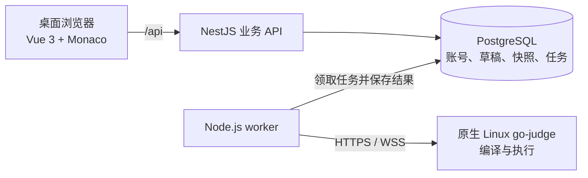

# 码上课堂 · C++ Classroom

[](https://github.com/Gentle-Lijie/CPP-Classroom/actions/workflows/ci.yml)[](https://vuejs.org/)[](https://www.typescriptlang.org/)[](https://nodejs.org/)

面向 C++ 与 Python（Beta）教学的浏览器编程教室，让讲题、写代码、编译运行、课堂巡视与作品收集在同一套工作区中完成。

学生打开浏览器即可练习，教师可以查看进度、处理求助、投屏讲解并收集作品。项目采用 Vue 3、Monaco、NestJS、PostgreSQL 与独立的原生 Linux 评测服务，提供中文桌面界面。

[在线访问](https://cpp.lijie.space) · [快速开始](#quick-start) · [系统架构](#architecture) · [部署指南](docs/deployment.md) · [项目文档](#documentation)


## 功能亮点

| 角色       | 主要功能                                                                                                                                 |
| ---------- | ---------------------------------------------------------------------------------------------------------------------------------------- |
| **学生**   | 加入课堂，使用 Monaco 编写 C++17/C++20 或 Python（Beta）程序，自动保存草稿，编译运行，发送交互输入与 EOF，查看历史、发起求助并提交作品。 |
| **教师**   | 创建课堂、导入名册、发布 Markdown 练习，使用授课模式讲解，在独立窗口巡视学生，查看代码与运行快照，处理求助并导出作品。                   |
| **管理员** | 管理账号与恢复申请、撤销会话、配置运行限额，查看服务健康与失败任务，创建数据库备份并验证恢复。                                           |

- **Python Support · Beta。** 代码区下拉菜单可切换 C++ / Python，每位学生和教师的两种语言草稿独立保存；题目可配置默认语言和各自的初始代码。Python 使用原生 Linux 节点上的 CPython 3，仅支持单文件、标准库及 stdin/stdout；包含交互输入、EOF、异常 traceback、历史与导出。
- **草稿自动保存。** 停止编辑后同步到服务器，断网时保留浏览器备份；多窗口修改发生冲突时明确提示，不静默覆盖。
- **代码与结果对应。** 每次运行和提交都关联不可变的代码版本，当前草稿与历史结果分别展示，便于复盘。
- **授课与巡视分屏。** 投影展示题目，另一块屏幕查看课堂进度；匿名投屏快照可撤销，并在两小时后过期。
- **保留文件工作流。** 支持 Markdown／JSON 题目导入，以及源文件 ZIP、CSV 清单和 JSON 导出；桌面 Chrome／Edge 还可连接本地工作目录。
- **按需开启代码补全。** C++ 使用浏览器内的 clangd；Python（Beta）使用独立 Web Worker 中的 Pyright，提供补全、诊断、悬停、签名及当前文件内的定义跳转和重命名。两者默认关闭，源码分析在浏览器本地完成。Python 语言服务首次开启下载约 20 MB 资源，固定采用 `monaco-pyright-lsp@0.1.7` 内的 Pyright 1.1.386 与类型存根。C++ 需要较新的桌面 Chrome／Edge，详见[浏览器要求](docs/browser-clangd.md)。

Python 仍处于 Beta，相关语言选择、编辑、运行和历史入口均显示胶囊标记。切换语言先保存当前草稿；运行中需先停止。下载和本地目录使用对应扩展名，另一种语言使用按题目 ID 生成的独立文件名，防止与命名题目覆盖。旧题目与旧记录按 C++ 兼容读取。科学计算包、Notebook、REPL 和多文件工程不在当前范围内。

升级现有环境须先执行 `pnpm db:migrate`，保留原有数据。原生执行节点需要 `/usr/bin/python3` 及完整标准库；部署检查使用 `pnpm runtime:probe`，业务链路检查使用 `pnpm acceptance:languages`（创建并归档独立的测试课堂，不修改现有课堂）。macOS 不代替 Linux 执行验收。

## 界面截图

从编写代码、定位错误到运行验证，再到教师巡视与作品交付，下面展示一套完整的课堂工作流。

| 编辑与调试                                        | 运行与历史                        | 教学与管理                                             |
| ------------------------------------------------- | --------------------------------- | ------------------------------------------------------ |
| clangd 成员补全、错误标记、GCC 编译诊断、深色主题 | 逐行交互输入、EOF、不可变运行快照 | 课堂总览、独立巡视、代码辅导、授课对照、题目编辑与导出 |

### 编辑器与调试

#### clangd 成员补全与函数签名

在 `std::vector<Student>` 上输入 `students.pu`，即可查看 `push_back` 的重载候选与参数签名。补全来自浏览器内的 clangd，图中保留了正在编写的代码与上一次运行结果。


#### 实时诊断：成员拼写与变量作用域

将 `push_back` 写成 `push_bak`，并使用未声明的 `count`，编辑器会显示红色波浪线与诊断计数。此时尚未点击编译运行，就可以开始定位问题；编辑期诊断与实际 GCC 编译结果分别呈现。


#### GCC 原始编译报错

实际编译后，“编译诊断”保留 GCC 返回的源文件名、行列位置、错误正文和候选拼写。图中选中的是这次失败的固定快照，代码、输入和报错对应同一次运行；查看历史不会重新执行程序。


#### 深色工作区

可切换浅色、深色或跟随系统。深色界面同时覆盖题面、Monaco、clangd 状态与输入输出面板；修正错误后重新编译，程序完成排序并输出平均分。


### 交互运行与历史

#### 程序运行中逐行输入

示例结合 `std::getline`、`std::istringstream` 与 `std::vector<int>` 处理输入流。分两次发送 `12 7 19` 和 `5 3` 后，程序实时输出 `count=3, sum=38` 与 `count=5, sum=46`，并继续等待下一行。


#### EOF 关闭标准输入

点击 EOF 真正关闭 stdin，读取循环结束，程序输出排序结果 `3 5 7 12 19` 后正常退出。运行记录保留输出和退出状态，输入区域随之关闭。


#### 运行历史与代码快照

侧栏可以切换成功和失败记录。选中某次运行后，工作区展示该次只读代码、固定输入和对应结果；当前草稿独立保留，可随时返回继续编辑。


### 教师授课与巡视

#### 课堂总览：进度、报错与求助

同一张表内查看在线状态、当前练习、最近运行与提交情况。演示课堂中同时包含编译成功、编译失败、已提交和请求帮助的学生，右侧可直接查看求助正文并进入辅导。


#### 独立巡视窗口

学生卡片汇总运行状态、提交和求助，支持按状态筛选并打开独立的学生窗口。授课页可以留在投影上，巡视窗口放在另一块显示器。


#### 查看学生代码与编译诊断

教师只读查看当前草稿与历史快照，结合原始编译错误和求助说明提供反馈。查看、投屏与处理求助不会直接修改学生代码。


#### 题面与教师示范代码对照

授课模式支持题面、代码和对照布局，并可调整代码字号。教师示范草稿独立保存，不覆盖学生作品；巡视窗口入口保持可见。


### 练习管理与作品交付

#### 练习列表与发布状态

按教学顺序组织练习，区分草稿、已发布和当前推荐题目。选择练习后可以查看学生题面预览，也可批量导入或编辑状态。


#### Markdown 编辑与实时预览

左侧编写 Markdown，右侧预览标题、列表、行内代码和代码块；下方配置输入输出说明及样例，初始代码在独立标签页维护。


#### 提交筛选与作品导出

按学生、练习与版本筛选主动提交，也可以独立导出当前草稿。支持 ZIP 源文件包、CSV 清单与 JSON，便于课后检查、归档和继续使用学生作品。


<a id="quick-start"></a>

## 快速开始

### 环境要求

- **Node.js 24**、**pnpm 11.20.0**，仓库已固定包管理器版本。
- **PostgreSQL 17+**，包含 `initdb`、`pg_ctl`、`pg_dump` 等原生工具。
- 用于编译运行的**原生 Linux go-judge 节点**。前端、API 和 worker 可在开发机运行，评测节点独立部署；macOS 执行支持属于实验性质，不作为生产沙箱验收依据。

macOS 可通过 `brew install postgresql@17` 安装并启动 PostgreSQL（`brew services start postgresql@17`）；Linux 使用原生服务端软件包。项目直接使用本机已有的 PostgreSQL 实例，不自带独立数据库进程。

### 启动项目

```sh
git clone https://github.com/Gentle-Lijie/CPP-Classroom.git
cd CPP-Classroom
pnpm install --frozen-lockfile
pnpm setup:local
```

`setup:local` 会生成带随机数据库密码的 `.env`，构建共享包并应用版本化 Drizzle 迁移。重复执行会保留已有配置与数据。首次使用需在本机 PostgreSQL 中创建同名角色与数据库（见下方"使用已有 PostgreSQL 实例"），迁移不会重置数据库。

在生成的 `.env` 中配置自己的 Linux 评测节点：

```dotenv
GO_JUDGE_URL=https://your-judge.example.com
GO_JUDGE_AUTH_TOKEN=your-server-side-token
GO_JUDGE_TIMEOUT_MS=10000
```

节点安装见[原生 go-judge 部署模板](infra/go-judge/README.md)。本项目的评测构建包含交互 EOF 与输出限额补丁，入口需同时支持 HTTP 和 WebSocket；令牌仅保存在服务端。

创建首个管理员，然后启动前端、API 与 worker：

```sh
# 请替换为自己的高强度密码。
ADMIN_PASSWORD='replace-with-a-strong-password' pnpm auth:bootstrap
pnpm dev
```

默认管理员用户名为 `admin`，可通过 `ADMIN_USERNAME` 指定其他名称。初始化脚本不会覆盖已有管理员的密码或权限。

| 服务            | 默认本地地址                                        |
| --------------- | --------------------------------------------------- |
| 前端登录页      | <http://127.0.0.1:5173/login>                       |
| API 健康检查    | <http://127.0.0.1:3000/api/health>                  |
| API 就绪检查    | <http://127.0.0.1:3000/api/health/readiness>        |
| 本地 PostgreSQL | `127.0.0.1:5432`（brew 服务，`brew services` 管理） |

端口配置见 [.env.example](.env.example)，Vite 将 `/api` 请求代理到 `VITE_API_TARGET`。按 Ctrl+C 停止开发进程；PostgreSQL 由系统服务管理（macOS 用 `brew services start/stop postgresql@17`）。

<details>
<summary>使用已有 PostgreSQL 实例</summary>

先在现有实例中创建数据库与访问凭据，再执行：

```sh
pnpm env:init
# 修改 .env 中的 DATABASE_URL，指向自己的数据库。
pnpm build:packages
pnpm db:migrate
```

随后创建管理员并运行 `pnpm dev`。迁移不会重置数据库。

</details>

### 创建第一个课堂

1. 使用管理员账号登录，创建教师账号。
2. 使用教师账号创建并开放课堂，导入学生名册或审批入班申请。
3. 新建练习，填写题目、输入输出样例和初始代码，然后发布。
4. 学生进入工作区编写、运行、求助和提交；教师通过课堂总览与授课模式跟进进度。

<a id="architecture"></a>

## 系统架构



API 负责身份、课堂权限、草稿与运行请求。独立 worker 从 PostgreSQL 领取持久化任务，再交给 go-judge 编译运行。**学生代码只在独立 Linux 评测节点执行**，业务 API 不执行学生程序，浏览器也不会获得评测令牌。

各服务均使用原生进程。PostgreSQL 保存执行任务，pg-boss 另用于基础设施自检队列；界面通过轮询更新状态。可选的 clangd 分析在浏览器中完成，与服务端编译执行相互独立。

| 层次     | 技术栈                                                                     |
| -------- | -------------------------------------------------------------------------- |
| 前端     | Vue 3 Composition API、TypeScript、Vite、shadcn-vue／Reka UI、Tailwind CSS |
| 编辑器   | Monaco、可选 SharedWorker／WASM clangd                                     |
| 业务 API | NestJS、会话 Cookie、服务端角色与课堂成员权限校验                          |
| 数据存储 | PostgreSQL、Drizzle ORM、版本化迁移                                        |
| 编译执行 | 独立 Node.js worker、原生 Linux go-judge、GCC                              |
| 部署     | EdgeOne Makers 前端、PM2 API／worker、原生 PostgreSQL、独立 Linux 评测节点 |

默认运行限额为 **CPU 2 秒**、**内存 256 MiB**、**输出 1 MiB**；非交互运行墙钟限时 **5 秒**，交互运行限时 **60 秒**。Linux namespace 与 cgroup 提供隔离和资源限制。交互功能支持逐行输入和 EOF 关闭 stdin，不提供终端或 shell。详见[执行与权限说明](docs/backend-implementation.md)。

## 开发与验证

```sh
pnpm check                # 共享包构建、类型检查、ESLint、Prettier
pnpm test                 # 自动化测试
pnpm build                # 构建全部应用与包
pnpm db:migrate           # 应用版本化迁移
pnpm queue:probe          # 验证队列与数据库集成，需要 worker 运行
```

修改数据库时使用 `pnpm db:generate` 生成版本化迁移，审查后再应用。`.env`、数据库文件、凭据和备份不进入 Git；提交 `.env.example`、迁移文件与 `pnpm-lock.yaml`。

仓库同时提供集成验收与压力测试工具：

| 命令                                      | 用途                                                          |
| ----------------------------------------- | ------------------------------------------------------------- |
| `pnpm acceptance`                         | 端到端验证权限、草稿、Linux 执行、输入／EOF、提交、投屏与导出 |
| `node scripts/product-acceptance.mjs`     | 产品 API 回归                                                 |
| `node scripts/account-acceptance.mjs`     | 账号归属、凭据交付、恢复与会话回归                            |
| `node scripts/revocation-acceptance.mjs`  | 使用真实 PostgreSQL 锁验证撤权竞态                            |
| `pnpm capacity:probe`                     | 创建合成的 50 人课堂，验证各学生的独立运行输出                |
| `pnpm backup:verify`                      | 原生备份，并恢复到独立临时数据库验证                          |
| `pnpm stress:test` / `pnpm stress:report` | 执行压力场景并生成图文 HTML 报告                              |

验收工具使用本地凭据，创建独立的合成账号与课堂；配置、证据与范围见[验收汇总](docs/audits/validation-summary-2026-10-26.md)。[已有压测报告](docs/stress-test-2026-10-25.md)记录的是测试环境中的 HTTP 并发与执行表现，不代表生产 SLA 或多课堂长期浏览器容量保证。

## 仓库结构

```text
apps/
  web/                 Vue 界面、Monaco、浏览器语言服务
  api/                 身份、课堂、草稿、教学与管理 API
  worker/              执行任务工作进程与队列自检
packages/
  contracts/           共享类型与默认限额
  config/              服务端环境配置
  database/            Drizzle schema、迁移与 PostgreSQL 连接
infra/go-judge/        原生服务模板、挂载配置与补丁
edge-functions/       托管前端的同源 API 代理
scripts/              本地启动、部署、备份、验收与压力测试工具
docs/                 设计、运维、验收与实现说明
```

<a id="documentation"></a>

## 项目文档

详细实现、运维和验收说明均可在仓库中查阅。

| 文档                                                     | 内容                                             |
| -------------------------------------------------------- | ------------------------------------------------ |
| [后端实现说明](docs/backend-implementation.md)           | 功能、权限、运行限额、验收与边界                 |
| [部署指南](docs/deployment.md)                           | Makers 前端、同源 API 代理、PM2 后端、升级与维护 |
| [原生 go-judge 部署](infra/go-judge/README.md)           | Linux 安装、systemd 模板、固定构建版本与课堂补丁 |
| [评测节点连接](docs/aim-radar-connection.md)             | 现有节点接入与连通检查                           |
| [浏览器 clangd](docs/browser-clangd.md)                  | 浏览器兼容性、资源加载、生命周期与分析限制       |
| [界面设计](docs/ui-design.md)                            | 桌面教学与编程界面规范                           |
| [验收汇总](docs/audits/validation-summary-2026-10-26.md) | 已记录的 API 与桌面浏览器验证                    |
| [最近界面验收](docs/audits/ui-fixes-2026-10-27.md)       | 只读编辑器、课堂切换与公共导航                   |
| [压力测试报告](docs/stress-test-2026-10-25.md)           | 测量结果、测试方法与在线图文报告                 |

## 当前范围

当前版本聚焦**桌面课堂中的单文件 C++ 控制台练习**，暂不包含隐藏测试自动判题、多文件工程、协作编辑、SSO 或内置 AI。移动端适配不在当前实现与验收范围内。
