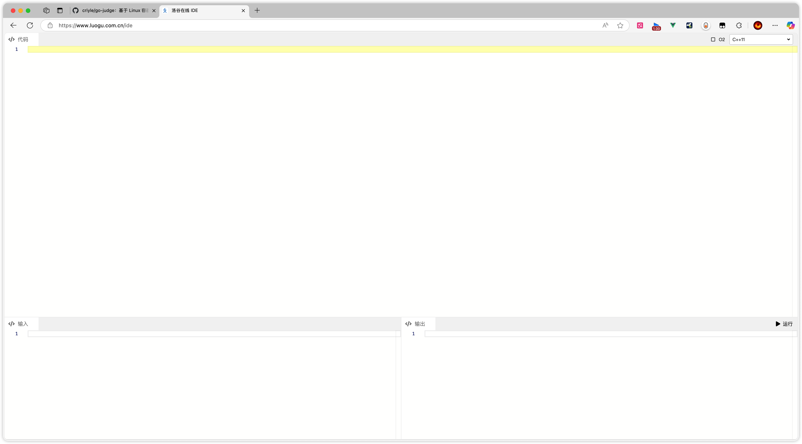

# IDE 布局参考（待实现）

用户指定参考洛谷在线 IDE，并明确当前阶段只搭框架，不实现页面或运行交互。

后续实现时保留这些布局特征：

- 全屏浅色工作区，顶部大代码编辑区，下部输入／输出左右分栏。
- 细浅灰分隔线、紧凑工具栏，避免额外的首页、宣传区或侧边管理布局。
- 顶部左侧显示“代码”，右侧提供 O2 和 C++ 标准选项。
- 底部各自标注“输入”“输出”，运行入口位于输出栏工具条右侧。
- 使用 Monaco 的真实文本编辑能力；后续可拖动调整区域大小。

界面使用 Vue 3／TypeScript、shadcn-vue，执行接入 go-judge。当前不引入 Monaco 功能实现，不伪造运行结果。C++ 默认标准及资源限制遵循后续确认的课程配置，不从截图中的选项值自动推定。
